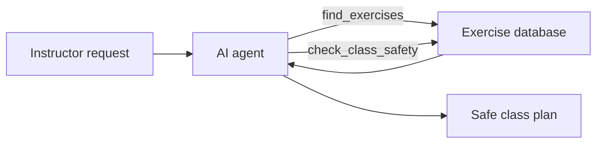

# Reformer Class Planner

An AI agent that helps Pilates instructors plan safe reformer classes.

I'm a Pilates reformer instructor and a Computer Science graduate. I built this tool for situations I run into as an instructor:

- **Last-minute changes.** I once planned an advanced class, and two minutes before it started I saw that the clients who came were older adults. The plan was not right for them, and I had to build a new class in my head on the spot.
- **Clients with injuries or special conditions**, like pregnancy. Every exercise has to fit the client's level and must not be contraindicated for their condition.
- **Fresh ideas.** Sometimes I just want to change my routine and nothing new comes to mind.

The agent plans the class, and code that I wrote checks that the result is safe.

## How it works

The instructor describes the client in plain language, for example:

> "Build a 50 minute beginner reformer class for a pregnant client."

The agent (Gemini, with function calling) decides which tools to use. The tools are plain Python functions that work on a database of 67 reformer exercises I wrote from my course materials.



The agent runs in a loop:

1. Send the whole conversation to the model.
2. If the model asks for a tool, the code runs the tool and adds the result to the conversation.
3. Repeat until the model answers with the final class (limited to 10 steps).

Example run:

```
Step 1: find_exercises({'level': 'beginner', 'conditions': ['pregnancy']})
Step 2: check_class_safety({'conditions': ['pregnancy'], 'exercise_ids': [...]})
<class plan: exercises, springs, repetitions and instructor cues>
```

## Safety by design

The model never decides on its own what is safe:

- **The code runs the tools, not the model.** The model only requests a tool call.
- **Contraindications live in the data**, written by an instructor, not generated by AI.
- **`check_class_safety`** verifies the final class against the client's conditions, and the agent is instructed to always run it before answering and to replace unsafe exercises.
- The model is instructed to use only exercises and spring settings that come from the tools.

## Tools

| Tool | What it does |
|---|---|
| `find_exercises(level, conditions)` | Returns exercises for a level that are safe for all of the client's conditions |
| `get_exercise_details(exercise_id)` | Returns the full details of one exercise |
| `check_class_safety(exercise_ids, conditions)` | Returns a list of problems. An empty list means the class is safe |

## Reliability

The free Gemini tier is sometimes overloaded (503 / 504 errors), so the AI client:

- uses a request timeout instead of waiting forever,
- falls back automatically to the next model in a list when a model is busy,
- catches only server errors, so real errors (like an invalid API key) are not hidden.

## Project structure

```
data/exercises.json   67 reformer exercises: series, springs, level, body focus, contraindications, description
tools.py              The agent's tools
agent.py              The agent loop with function calling and system instructions
ai_client.py          Gemini client with timeout and model fallback
planner.py            A simple pipeline version (code filters exercises, AI writes the class), kept for comparison
test_models.py        Checks which Gemini models are currently available
```

## Running it

Requires Python 3.10+ and a free Gemini API key from [Google AI Studio](https://aistudio.google.com).

```bash
git clone https://github.com/Maya-Mel/reformer-class-planner.git
cd reformer-class-planner
python -m venv .venv
.venv\Scripts\Activate.ps1        # Windows. On macOS/Linux: source .venv/bin/activate
pip install -r requirements.txt
```

Create a `.env` file in the project folder:

```
GEMINI_API_KEY=your_key_here
```

Run the agent:

```bash
python agent.py
```

## Tech stack

Python, Google Gemini API (`google-genai`), function calling, python-dotenv, Git and GitHub.

## Roadmap

- [x] Exercise database
- [x] Safety tools
- [x] AI agent with function calling
- [ ] Improve the data (see [Issues](https://github.com/Maya-Mel/reformer-class-planner/issues))
- [ ] Classes with props: ball, ankle and hand weights, foam roller, magic circle, box
- [ ] Web API with FastAPI
- [ ] A web form for instructors: choose the class level, focus areas (glutes, core, arms, legs, back and more), props and contraindications, and get a class plan
- [ ] Docker and deployment to AWS
