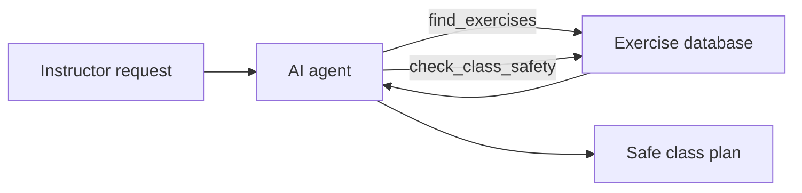

# Reformer Class Planner

[](https://github.com/Maya-Mel/reformer-class-planner/actions/workflows/tests.yml)

An AI agent that helps Pilates instructors plan safe reformer classes.

I'm a Pilates reformer instructor and a Computer Science graduate. I built this tool for situations I run into as an instructor:

- **Last-minute changes.** I once planned an advanced class, and two minutes before it started I saw that the clients who came were older adults. The plan was not right for them, and I had to build a new class in my head on the spot.
- **Clients with injuries or special conditions**, like pregnancy. Every exercise has to fit the client's level and must not be contraindicated for their condition.
- **Fresh ideas.** Sometimes I just want to change my routine and nothing new comes to mind.

The agent plans the class, and code that I wrote checks that the result is safe.

## How it works

The instructor describes the client in plain language, for example:

> "Build a 50 minute beginner reformer class for a pregnant client."

The agent (Gemini, with function calling) decides which tools to use. The tools are plain Python functions that work on a database of 67 reformer exercises I wrote from my course materials.



The agent runs in a loop:

1. Send the whole conversation to the model.
2. If the model asks for a tool, the code runs the tool and adds the result to the conversation.
3. Repeat until the model answers with the final class (limited to 10 steps).

Example run:

```
Step 1: find_exercises({'level': 'beginner', 'conditions': ['pregnancy']})
Step 2: check_class_safety({'conditions': ['pregnancy'], 'exercise_ids': [...]})
<class plan: exercises, springs, repetitions and instructor cues>
```

## Safety by design

The model never decides on its own what is safe:

- **The code runs the tools, not the model.** The model only requests a tool call.
- **Contraindications live in the data**, written by an instructor, not generated by AI.
- **`check_class_safety`** verifies the final class against the client's conditions, and the agent is instructed to always run it before answering and to replace unsafe exercises.
- The model is instructed to use only exercises and spring settings that come from the tools.

## Tools

| Tool | What it does |
|---|---|
| `find_exercises(level, conditions)` | Returns exercises for a level that are safe for all of the client's conditions |
| `get_exercise_details(exercise_id)` | Returns the full details of one exercise |
| `check_class_safety(exercise_ids, conditions)` | Returns a list of problems. An empty list means the class is safe |

## Using the tools from Claude Code (MCP)

`mcp_server.py` is an MCP server that exposes the same three tools to MCP clients such as Claude Code. This way you can ask Claude directly, for example "Is the Hundred safe for a pregnant client?", and Claude calls `check_class_safety`. The server only wraps the functions from `tools.py`. The safety logic and the data stay the same, and no Gemini request is sent.

The server is connected through `.mcp.json` in the project folder:

```json
{
  "mcpServers": {
    "reformer-class-planner": {
      "command": ".venv/Scripts/python.exe",
      "args": ["mcp_server.py"]
    }
  }
}
```

When you open the project in Claude Code, it reads this file, asks you to approve the server, and starts it in the background with the project's venv. The path `.venv/Scripts/python.exe` is for Windows. On macOS/Linux, change it to `.venv/bin/python`.

## Reliability

The free Gemini tier is sometimes overloaded (503 / 504 errors), so the AI client:

- uses a request timeout instead of waiting forever,
- falls back automatically to the next model in a list when a model is busy,
- catches only server errors, so real errors (like an invalid API key) are not hidden.

## Project structure

```
data/exercises.json   67 reformer exercises: series, springs, level, body focus, contraindications, description
tools.py              The agent's tools
agent.py              The agent loop with function calling and system instructions
ai_client.py          Gemini client with timeout and model fallback
planner.py            A simple pipeline version (code filters exercises, AI writes the class), kept for comparison
check_models.py       Checks which Gemini models are currently available
mcp_server.py         MCP server that exposes the tools to Claude Code
.mcp.json             Connects the MCP server to Claude Code
Dockerfile            Builds an image that runs the web app with uvicorn
.dockerignore         Keeps .env, .venv and .git out of the image
```

## Running it

Requires Python 3.10+ and a free Gemini API key from [Google AI Studio](https://aistudio.google.com).

```bash
git clone https://github.com/Maya-Mel/reformer-class-planner.git
cd reformer-class-planner
python -m venv .venv
.venv\Scripts\Activate.ps1        # Windows. On macOS/Linux: source .venv/bin/activate
pip install -r requirements.txt
```

Create a `.env` file in the project folder:

```
GEMINI_API_KEY=your_key_here
```

Run the agent:

```bash
python agent.py
```

Run the tests. They check the tools, the API and the exercise data. They don't send any requests to Gemini, but a `GEMINI_API_KEY` must still be set (any value works), because loading the API creates the Gemini client:

```bash
python -m pytest
```

To run only the MCP server tests (they don't need `GEMINI_API_KEY`):

```bash
python -m pytest tests/test_mcp_server.py
```

## Running with Docker

You can also run the web app in a Docker container. Build the image once (and again after every code change):

```bash
docker build -t reformer-class-planner .
```

Run it and open `http://127.0.0.1:8000`:

```bash
docker run --rm -p 8000:8000 --env-file .env reformer-class-planner
```

The API key is never part of the image. `.dockerignore` keeps `.env` (and `.venv`, `.git`) out of the build, and `--env-file .env` passes the key to the container only while it runs. Write the key in `.env` without quotes (`GEMINI_API_KEY=your_key_here`), because `--env-file` keeps quotes as part of the value.

## Tech stack

Python, Google Gemini API (`google-genai`), function calling, python-dotenv, pytest, Git and GitHub.

## Roadmap

- [x] Exercise database
- [x] Safety tools
- [x] AI agent with function calling
- [ ] Improve the data (see [Issues](https://github.com/Maya-Mel/reformer-class-planner/issues))
- [ ] Classes with props: ball, ankle and hand weights, foam roller, magic circle, box
- [x] Web API with FastAPI
- [x] A web form for instructors: choose the class level, focus areas (glutes, core, arms, legs, back and more) and contraindications, and get a class plan
- [x] Docker
- [ ] Deployment to the cloud
